# Tân Thời — Trang tin điện tử tiếng Việt

**Tân Thời** là một trang báo điện tử tiếng Việt hoàn chỉnh về giao diện: trang nhất kiểu báo in, bài viết có giọng đọc, bình luận, tin trực tiếp, công thức nấu ăn, podcast, video dạng truyện dọc, bản tin email, trò chơi chữ tiếng Việt và khu quản lý tài khoản / gói đọc.

> ⚠️ Đây là **sản phẩm demo giao diện** do [Ntahien Tech](https://ntahientech.com) thiết kế và lập trình. Mọi bài viết, nhân vật, phóng viên, đội bóng, sự kiện đều **hư cấu**. Không có máy chủ: tài khoản, bình luận, gói đọc chỉ lưu trong trình duyệt của bạn (localStorage). Trang thanh toán là **giả lập** — không thu thông tin thẻ thật, không có giao dịch thật. Ảnh lấy từ Wikimedia Commons theo giấy phép tự do, ghi nguồn dưới mỗi ảnh.

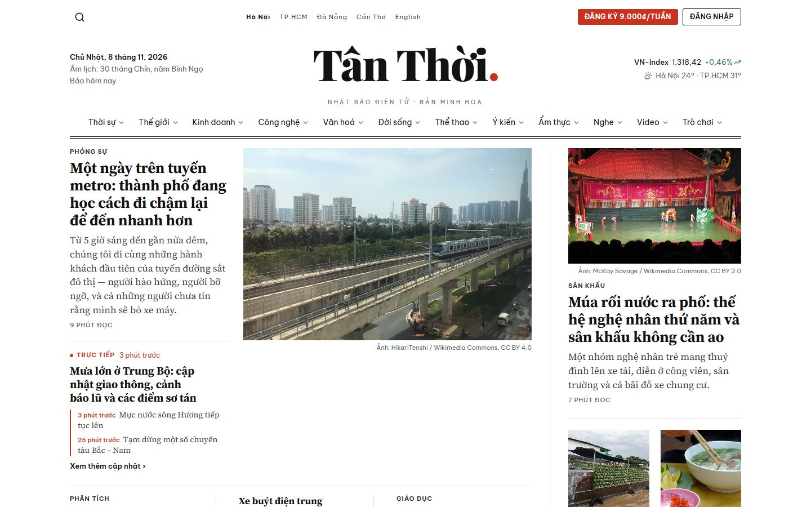

## Ảnh giao diện

| Bài viết, nghe bằng giọng đọc | Bình luận |
|---|---|
| 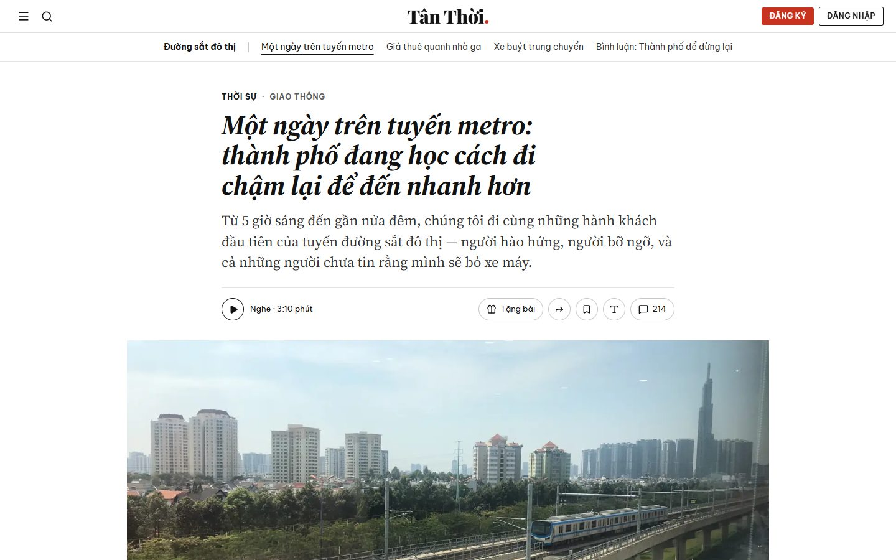 | 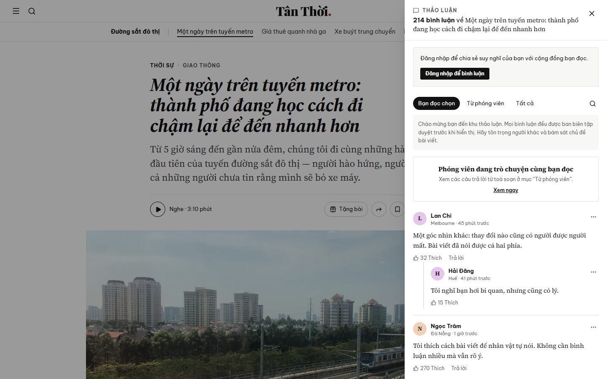 |
| **Tin trực tiếp** | **Khu trò chơi** |
| 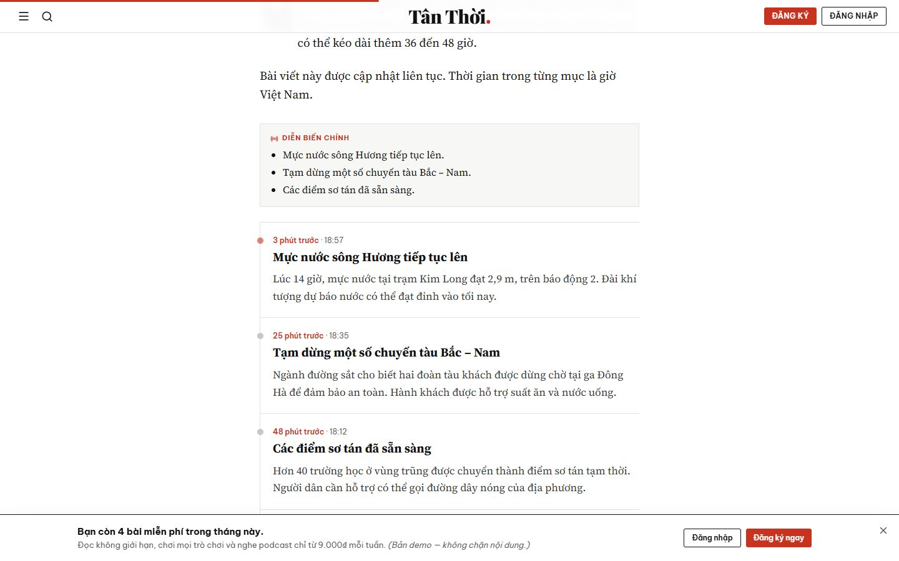 | 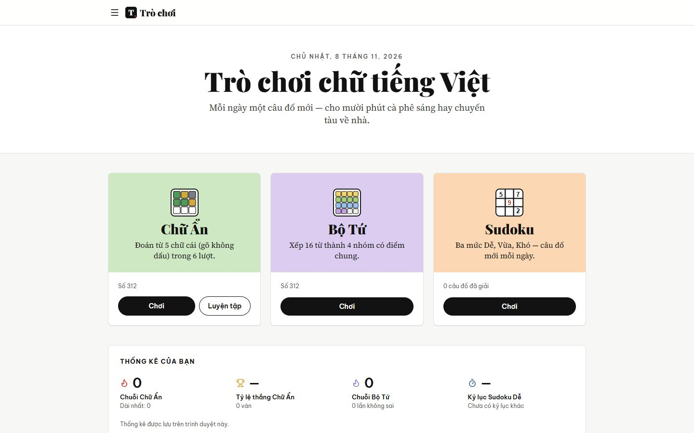 |
| **Chữ Ẩn — đoán từ tiếng Việt** | **Bộ Tứ** |
| 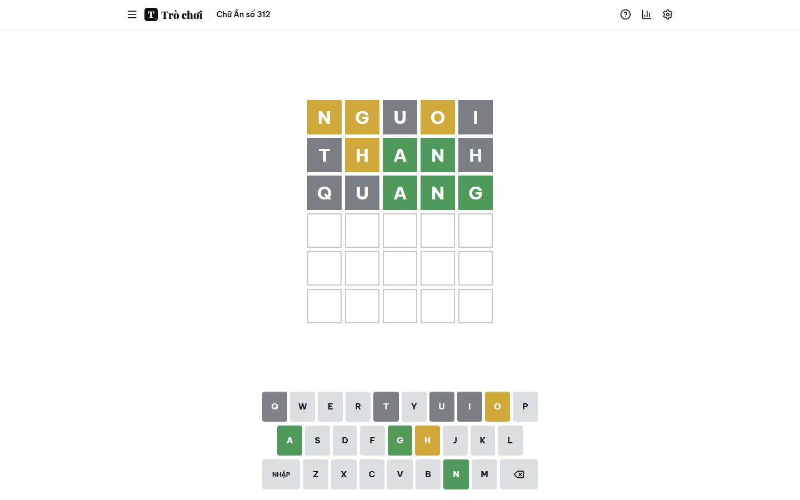 | 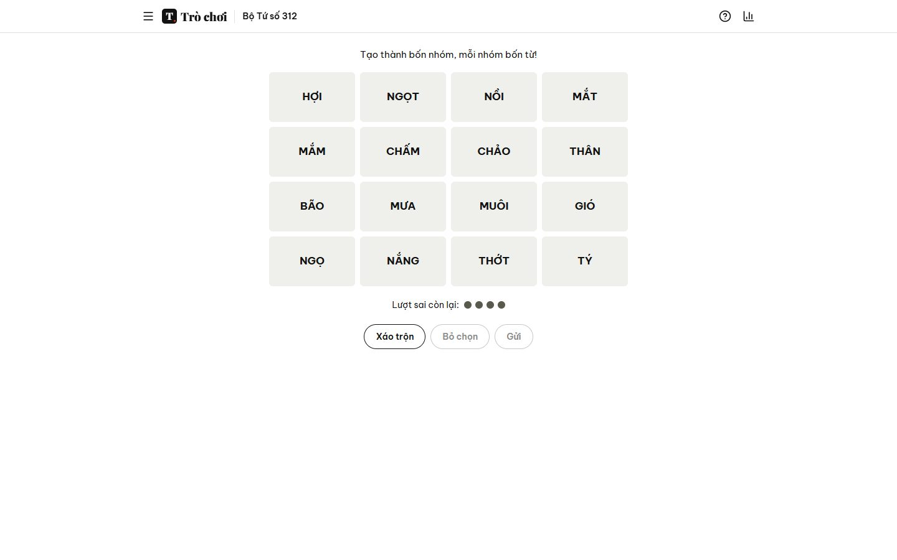 |
| **Sudoku** | **Podcast** |
| 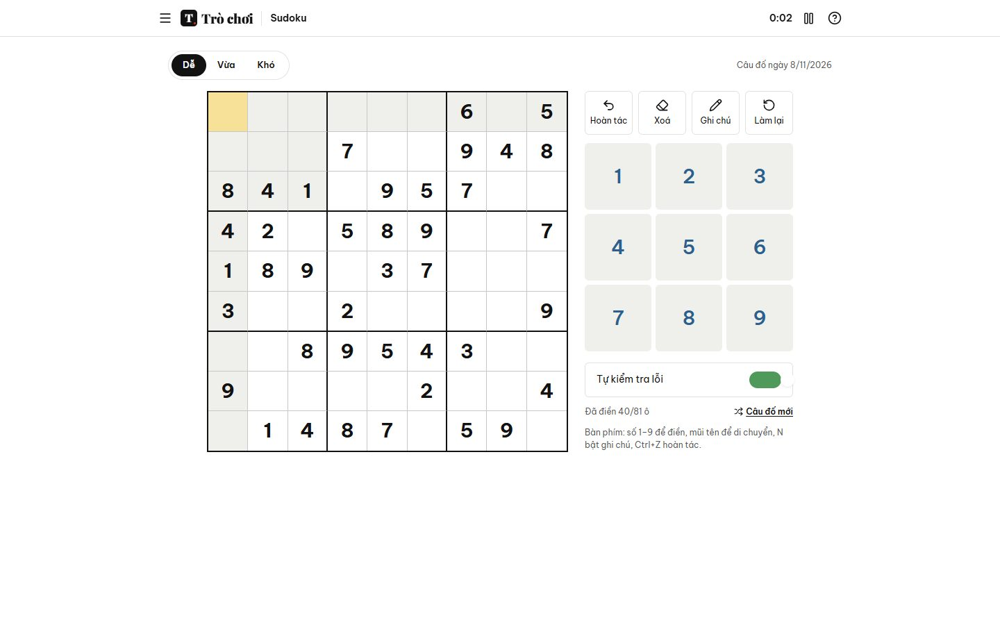 | 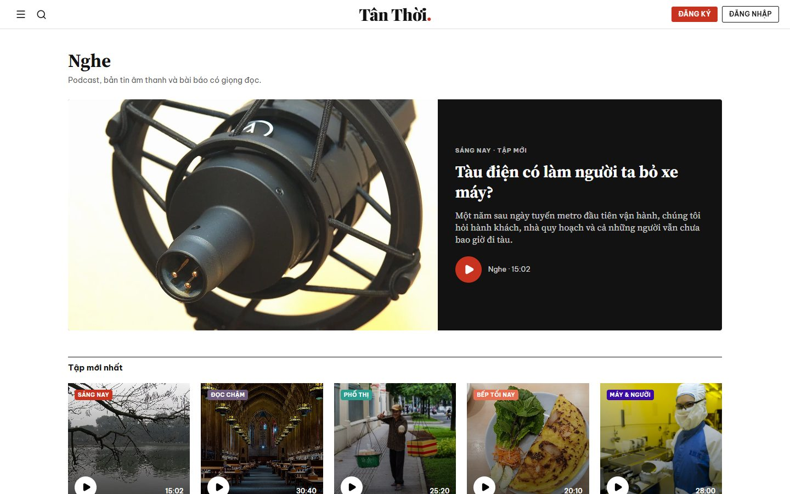 |
| **Video dạng truyện dọc** | **Tìm kiếm không dấu** |
| 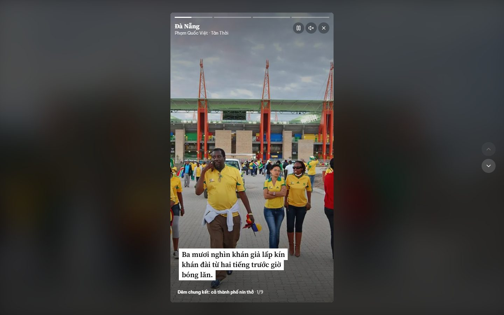 | 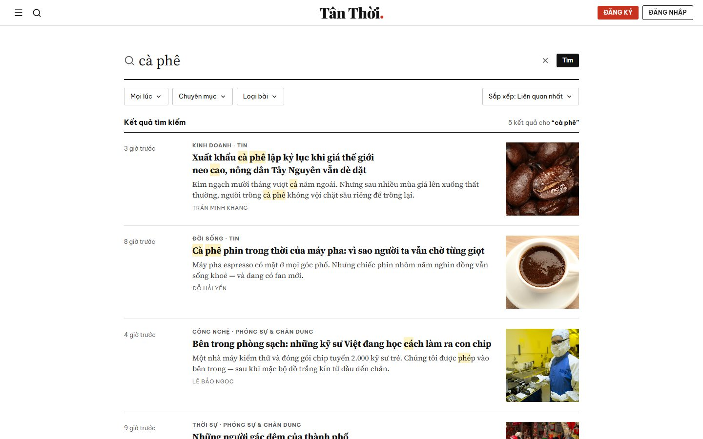 |
| **Bản tin email** | **Thanh toán (giả lập)** |
| 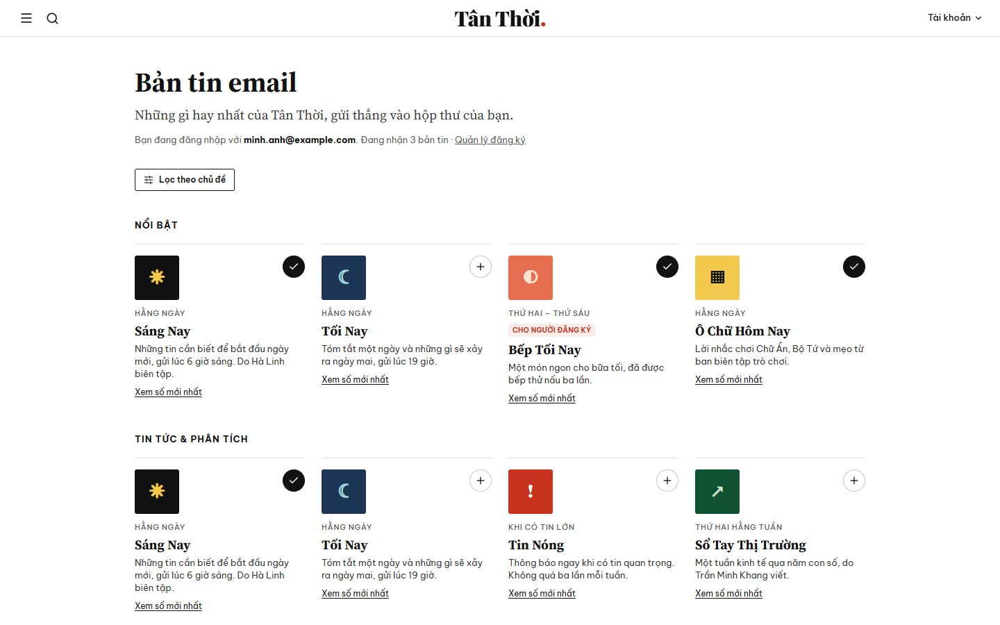 | 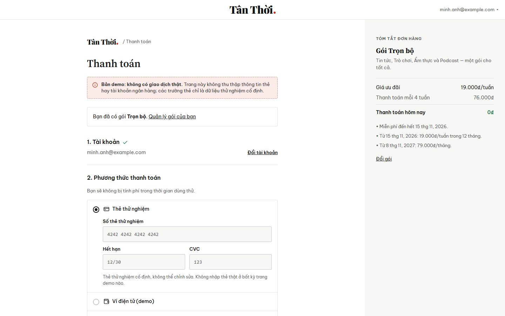 |
| **Trung tâm tài khoản** | **Chế độ tối** |
| 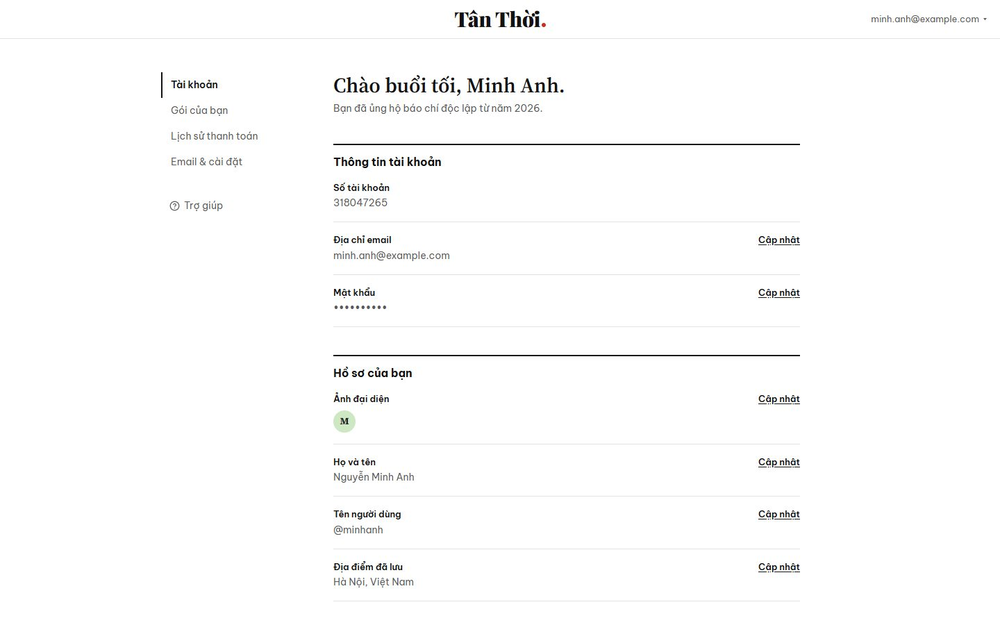 | 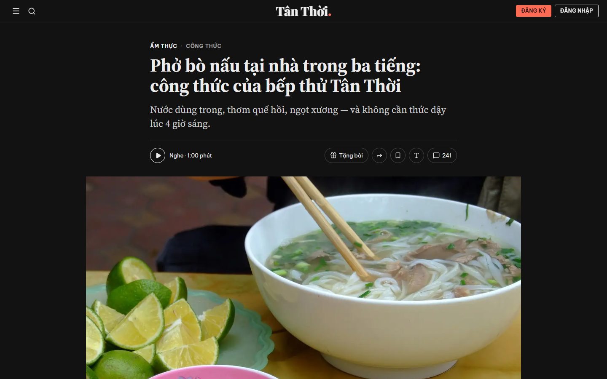 |

## Tính năng

**Đọc báo**
- Trang nhất bố cục báo in: măng-sét có ngày dương và **ngày âm lịch**, chỉ số thị trường, menu chuyên mục thả xuống, thanh gọn khi cuộn
- Bài viết: thanh tiến độ đọc, **nghe bài bằng giọng đọc tiếng Việt** (Web Speech API), tặng bài, chia sẻ, lưu bài, chỉnh cỡ chữ
- Tin **trực tiếp** với dòng thời gian cập nhật, **công thức** có danh sách nguyên liệu đánh dấu được, **chế độ nấu** giữ màn hình sáng, chấm sao
- Bình luận: “Bạn đọc chọn”, “Từ phóng viên”, tất cả; viết / trả lời (chờ duyệt), thích, báo cáo vi phạm, tìm trong bình luận
- Chuyên mục, tác giả, tìm kiếm không dấu có bộ lọc (thời gian, chuyên mục, loại bài, sắp xếp), danh sách đọc, “Báo hôm nay”
- Chế độ sáng / tối / theo máy

**Nghe & xem**
- Podcast có trình phát, tốc độ, tua ±15 giây và bản ghi lời tô sáng theo câu
- Video dạng truyện dọc toàn màn hình (ảnh chuyển động, chú thích theo cảnh)

**Trò chơi**
- **Chữ Ẩn**: đoán từ tiếng Việt 5 chữ cái (không dấu), lộ nghĩa có dấu khi kết thúc, thống kê, chia sẻ kết quả
- **Bộ Tứ**: xếp 16 từ thành 4 nhóm
- **Sudoku** 3 mức độ, ghi chú, hoàn tác
- **Tự tạo Chữ Ẩn** và gửi liên kết cho bạn bè

**Tài khoản & gói đọc (giả lập)**
- Đăng nhập / tạo tài khoản / quên mật khẩu, luồng chào mừng 3 bước
- Gói đọc, dùng thử 7 ngày, thanh toán thử nghiệm, gói gia đình
- Trung tâm tài khoản: hồ sơ, ảnh đại diện, địa điểm, bản tin email, lịch sử thanh toán, huỷ gói, xoá tài khoản

## Công nghệ

React 19 · Vite 6 · Tailwind CSS v4 · Zustand · React Router 7 · lucide-react. Phông chữ: Source Serif 4, Playfair Display, Be Vietnam Pro (đều hỗ trợ tiếng Việt).

## Chạy trên máy

```bash
npm install
npm run dev      # http://localhost:5191
npm run build    # xuất ra thư mục dist/
```

## Triển khai lên Vercel

Dự án nằm ở thư mục gốc, Vercel tự nhận Vite — chỉ cần **Import** repo, giữ mặc định (Build: `npm run build`, Output: `dist`). File `vercel.json` đã cấu hình điều hướng cho ứng dụng một trang.

## Cấu trúc

```
src/
  data/          bài viết (articles/*), tác giả, chuyên mục, bản tin, bình luận mẫu, ảnh, podcast & video
  components/    măng-sét, menu, chân trang, khối bài viết, thành phần giao diện
  features/      công cụ bài viết, giọng đọc, bình luận, trò chơi, media, tài khoản
  pages/         các trang (trang nhất, bài viết, chuyên mục, trò chơi, tài khoản…)
  routes/        định tuyến theo khu vực
  store/         trạng thái (giao diện, tài khoản demo, bình luận)
```

Muốn thêm bài: thêm một object vào một file trong `src/data/articles/`.
